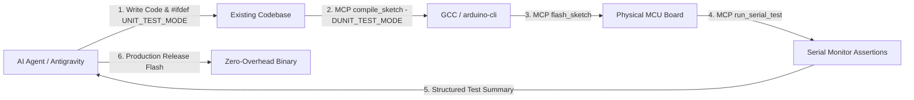

# 🚀 Thruster

**Thruster** is a lightweight, zero-overhead extension for **Antigravity IDE** and **VS Code** that elevates embedded microcontroller development into a next-generation **Agentic Development Platform** across **macOS, Windows, and Linux**.

With **Version 1.0.0**, Thruster introduces autonomous **Agent-Driven MCU Development** combining **Preprocessor-Guarded Detachable Testing** (`#ifdef UNIT_TEST_MODE`) via Serial, zero release overhead, and a built-in **Model Context Protocol (MCP) Server**.

---

## 🤖 What's New in v1.0.0: Autonomous Agentic MCU Development

Thruster 1.0.0 bridges the gap between AI pair programmers (Google Antigravity IDE, Claude, etc.) and physical microcontrollers. Rather than forcing your project into a rigid or invasive architecture, Thruster is **completely universal**: it works with whatever coding style your project already uses—procedural functions, object-oriented classes, state machines, or legacy Arduino sketches.



### 1. Preprocessor-Guarded Detachable Testing (`#ifdef UNIT_TEST_MODE`)
* **Zero Architecture Tax:** Write tests directly alongside your functional logic or in a test block without restructuring your project:
  ```cpp
  int clamp_and_scale(int raw, int min_in, int max_in, int out_max) {
      if (raw <= min_in) return 0;
      if (raw >= max_in) return out_max;
      return (int)((long)(raw - min_in) * out_max / (max_in - min_in));
  }

  #ifdef UNIT_TEST_MODE
  void run_unit_tests(void) {
      bool pass1 = (clamp_and_scale(500, 1000, 4000, 255) == 0);
      bool pass2 = (clamp_and_scale(4500, 1000, 4000, 255) == 255);

      Serial.println(pass1 ? "[PASS] Below min clamps to 0" : "[FAIL] Below min clamps to 0");
      Serial.println(pass2 ? "[PASS] Above max clamps to out_max" : "[FAIL] Above max clamps to out_max");
  }
  #endif
  ```
* **Zero Production Overhead:** In production releases, `UNIT_TEST_MODE` is undefined. The preprocessor strips all test functions, assertion checks, and string literals—**0 bytes of Flash, 0 bytes of RAM, 0 CPU cycles**.

### 2. Built-In Thruster MCP Server (`.agents/mcp_config.json`)
Thruster bundles a native, zero-dependency Node.js MCP server providing tools for the AI agent:
* 🛠️ `compile_sketch`: Compiles firmware, parses compiler errors with line numbers, and returns Flash & RAM metrics. Pass `test_mode: true` to compile with `-DUNIT_TEST_MODE=1`.
* ⚡ `flash_sketch`: Automatically detects ports and uploads firmware.
* 🧪 `run_serial_test`: Connects to Serial, captures `[PASS]` and `[FAIL]` markers, and cleanly auto-releases the port.
* 📡 `read_serial` & `write_serial`: Low-level serial communication and log streaming.
* ⚙️ `get_mcu_config` & `set_mcu_config`: Inspects and updates board FQBN, port, and baud rate.

### 3. Silent & Seamless Project Setup
* When you run `Thruster: Initialize Project`, Thruster silently configures `.agents/skills/` and `.agents/mcp_config.json` in the background with zero intrusive modal prompts.
* Your AI agent is immediately equipped to compile, flash, and test your code autonomously.

---

## ⚡ Core Features & Highlights

* 💻 **Cross-Platform Support:** Fully compatible with **macOS** (Apple Silicon M1/M2/M3/M4 & Intel), **Windows 10/11**, and **Linux**.
* 🎯 **Broad Multi-MCU Support:** Works out of the box with ESP32, ESP8266, Arduino Uno/Nano/Mega/Due, Raspberry Pi Pico (RP2040 / RP2350), STM32, and any custom board.
* ⚡ **Instant Flash (Smart Compile Skipping):** Automatically tracks source code fingerprints across `.ino`, `.cpp`, and `.h` files. If the code hasn't changed since the last build, the compile stage is skipped and firmware is uploaded directly to the board.
* 📊 **Clean Single-Line Progress Bar & Memory Stats:** Replaces noisy multiline upload output with an elegant, in-place updating single-line progress bar and an instant breakdown of Program Flash and Dynamic RAM usage.
* 📁 **Automated Log & Crash Retention (`.thruster`):** Detailed verbose upload logs and crash diagnostics are cleanly organized into `.thruster/logs` and `.thruster/crashes`. Retains the 10 latest logs by default (configurable in settings).
* 🔄 **Smart Serial Monitor Management:** Whenever you click **Compile**, **Flash**, or switch settings while the Serial Monitor is active, Thruster automatically and cleanly exits the serial monitor, frees the serial port, and executes your command without typing command strings into the serial stream.
* ⚙️ **Unified Settings & Control Center:** All configuration (Agentic MCU tools, Smart Library Auto-Resolver, baud rate, target board, serial port, and toolchain checks) is unified in a single dashboard accessible via the top-right toolbar.
* 📋 **Extension Readiness Checklist:** Live health checks ensuring your `arduino-cli` binary and Agentic setup are operational.
* ⚡ **One-Click `arduino-cli` Setup:** Automatic system detection or single-click automated download & installation of the official `arduino-cli` binary.
* 🧠 **Smart Library Auto-Resolver:** Automatically catches missing `#include <Library.h>` headers during compilation, searches the official Arduino registry, installs missing libraries, and recompiles.
* 🚀 **Editor Toolbar Controls:** Python-style run buttons in the top-right corner of any `.ino` sketch: **Compile**, **Flash (Upload)**, **Flash & Monitor**, and **Serial Monitor**.
* 🔌 **Auto USB Port Detection:** Dynamically resolves connected USB serial ports (`/dev/cu.*` on macOS, `COM*` on Windows, `/dev/ttyUSB*` on Linux).

---

## 🔌 Supported Microcontrollers (Multi-MCU)

Thruster features built-in presets and automatic toolchain downloads for popular microcontroller families:

| Architecture / Platform | Popular Supported Boards |
| :--- | :--- |
| **Espressif ESP32** | NodeMCU-32S, ESP32 Dev Module, ESP32-S2, ESP32-S3 (Native USB / USB OTG), ESP32-C3 SuperMini (RISC-V) |
| **Espressif ESP8266** | NodeMCU 1.0 (ESP-12E), Generic ESP8266 Module |
| **Classic Arduino (AVR)** | Arduino Uno R3 (ATmega328P), Arduino Nano, Arduino Mega / Mega 2560 |
| **Modern 32-bit Arduino** | Arduino Uno R4 Minima (Renesas RA4M1), Arduino Uno R4 WiFi, Arduino Uno WiFi Rev2 |
| **ARM Cortex-M3 (Atmel SAM)** | Arduino Due (Programming Port & Native USB Port) |
| **Raspberry Pi Silicon** | Raspberry Pi Pico (RP2040 Dual Cortex-M0+), Raspberry Pi Pico 2 (RP2350) |
| **STMicroelectronics STM32** | Generic STM32F1 Series (BluePill), STM32F4 |
| **Custom Boards** | Any installed core or custom FQBN via **🔍 Search All Installed Boards** or **Custom FQBN...** |

> **Automated Core Installation:** When you select a board whose toolchain isn't installed yet (e.g. ESP32, ESP8266, RP2040, or Renesas RA4M1), Thruster automatically updates the package index and installs the required core package via `arduino-cli`.

---

## 🚀 Getting Started with Agentic MCU Development

### Step 1: Initialize Project
1. Open your project folder in **Antigravity IDE** or **VS Code**.
2. Click **Initialize Project** `$(rocket)` in the top-right toolbar (or press `Cmd+Shift+P` / `Ctrl+Shift+P` -> `Thruster: Initialize Project`).
3. Select your target board, USB port, and baud rate.
4. Thruster sets up `.vscode/arduino.json` and automatically equips `.agents/skills/` and `.agents/mcp_config.json` in the background—ready for AI pair programming.

### Step 2: Develop with your AI Agent
Prompt your AI agent:
> *"Implement a battery voltage to PWM calculation function with low-voltage cutoff, add unit test assertions under #ifdef UNIT_TEST_MODE, and verify it via Serial using Thruster MCP tools."*

Your agent will:
1. Write the function and its `#ifdef UNIT_TEST_MODE` test block.
2. Call `compile_sketch` with `test_mode: true` to compile with `-DUNIT_TEST_MODE=1`.
3. Call `flash_sketch` to upload to the microcontroller.
4. Call `run_serial_test` to verify `[PASS]` assertion output over Serial.

### Step 3: Production Release Deploy
Once your firmware is verified:
* Hitting **Flash** `$(zap)` in the editor compiles and flashes standard production firmware without `UNIT_TEST_MODE`—100% clean, optimal binary with zero test strings or overhead!

---

## ⚙️ Unified Control Center & Checklist

Access the unified dashboard via the **`Settings`** `$(gear)` icon in the top-right toolbar:

* **📋 Step 1 — Valid `arduino-cli` binary:** Live verification of your compiler backend with 1-click auto-install.
* **📋 Step 2 — Agentic MCU Development:** Live check showing whether Antigravity Skill and MCP Server are active.
* **🧠 Smart Library Auto-Resolver:** Configure resolver behavior (`Auto`, `With warning`, or `Off`).
* **📁 Retention Logs:** Inspect or clear the latest 10 flash logs and crash logs.
* **🎯 Target Hardware:** Switch boards and ports on the fly.

---

## 🛠️ Toolbar & Status Bar Quick Controls

### 1. Editor Title Toolbar (Top-Right Action Buttons)
When opening any `.ino` sketch:

* **Before Initialization:**
  * Displays an **Initialize Project** `$(rocket)` button.

* **After Initialization:**
  * ⚡ **`Flash (Upload)`** `$(zap)`: One-click compile & upload to the connected board.
  * 🚀 **`Flash & Monitor`** `$(run-all)`: Compiles, flashes, and immediately launches the interactive Serial Monitor in the terminal.
  * ✔️ **`Compile / Verify`** `$(check)`: Fast verification and compilation without uploading.
  * 📡 **`Serial Monitor`** `$(radio-tower)` / ⏹️ **`Stop Serial Monitor`** `$(debug-stop)`: Connects to the board's serial console. While monitoring, the button dynamically changes to **Stop Serial Monitor** for effortless 1-click detachment.
  * ⚙️ **`Settings`** `$(gear)`: Opens the Thruster Settings & Readiness Checklist.

### 2. Status Bar Controls (Bottom-Left)
* `$(circuit-board) Board Name`: Click to switch target microcontroller on the fly.
* `$(plug) Port: Auto (or /dev/cu... / COM...)`: Click to select or rescan serial ports.

---

## 💬 Issues, Bug Reports & Community

Thruster is open-source! We welcome feedback, bug reports, and board support requests:

* **GitHub Repository:** [https://github.com/the-biKing/Thruster.git](https://github.com/the-biKing/Thruster.git)
* **Report an Issue:** [https://github.com/the-biKing/Thruster/issues](https://github.com/the-biKing/Thruster/issues)

If you encounter an issue or have an idea to make embedded programming smoother, please [file an issue on GitHub](https://github.com/the-biKing/Thruster/issues) and we will be happy to help.

---

## 📄 License

MIT License &copy; [the-biKing](https://github.com/the-biKing)
