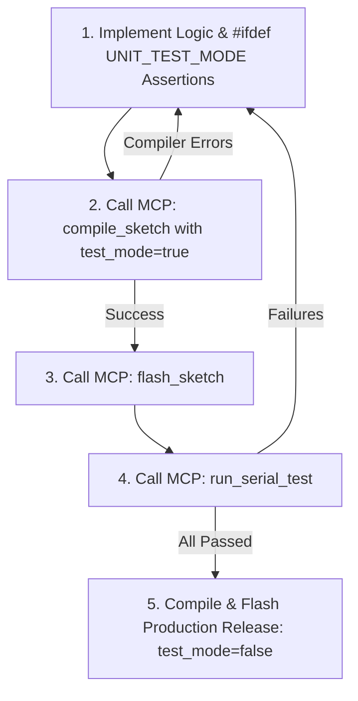

# Microcontroller Preprocessor-Guarded Unit Testing (MCU Agentic Testing)

This skill guides you through developing, testing, and verifying embedded microcontroller firmware using **Preprocessor-Guarded Detachable Unit Testing** (`#ifdef UNIT_TEST_MODE`), validated autonomously over Serial via the **Thruster MCP Server**.

---

## 1. Pragmatic Scope: Autonomous Testing vs. Human Hand-Off

Microcontroller firmware blends pure computational logic with physical, analog, and optical hardware side effects. Always apply this decision framework:

### ✅ Test Autonomously via MCP:
- **Pure algorithms, math formulas, threshold checks, calibration curves** (e.g. ADC conversion, PID algorithms, sensor scaling).
- **State machine logic and discrete event transitions** (e.g. connection states, debounce logic, operational mode shifts).
- **Packet decoders/encoders, checksums, circular/ring buffers** (e.g. NMEA/GPS parsers, framing bytes, ring buffer wrapping).

### ✋ Skip Autonomous Tests & Hand Off to Human:
- **Physical/visual side effects** (e.g. blinking an LED, PWM brightness, OLED/TFT graphic layouts, buzzer tones, motor spinning).
- **Direct one-line HAL pin calls** (`digitalWrite()`, `analogRead()`, `pinMode()`).
- **Hardware setup and wiring verification** (e.g. loose jumper wires, pull-up/down resistors, external power rails).

> **Rule:** If the task is primarily physical or visual, compile and flash with `test_mode: false`, then stop and ask the user to verify manually:
> *"Firmware flashed successfully. Please observe the board and verify that the LED blinks / the motor runs at the expected rate."*

---

## 2. Core Principles & Architecture

### 1. Separate Pure Logic from Direct Hardware I/O
Keep calculations, conversions, and parsers decoupled from hardware reads/writes. This allows mathematical logic to be verified on-target independently of physical sensors.

#### Pattern A: Generic Math / Boundary Logic (under 15 lines)
```cpp
int clamp_and_scale(int raw, int min_in, int max_in, int out_max) {
    if (raw <= min_in) return 0;
    if (raw >= max_in) return out_max;
    return (int)((long)(raw - min_in) * out_max / (max_in - min_in));
}
```

#### Pattern B: State Machine / Packet Decoder Logic (under 15 lines)
```cpp
enum SystemState { STATE_IDLE = 0, STATE_ACTIVE = 1, STATE_ERROR = 2 };

bool parse_command_packet(uint8_t byte, SystemState* state) {
    if (!state) return false;
    if (byte == 0xA5) { *state = STATE_ACTIVE; return true; }
    if (byte == 0x5A) { *state = STATE_IDLE; return true; }
    if (byte == 0xFF) { *state = STATE_ERROR; return true; }
    return false; // Unknown / invalid packet byte
}
```

### 2. Preprocessor-Guarded Tests (`#ifdef UNIT_TEST_MODE`)
- Wrap test functions and assertion checks inside `#ifdef UNIT_TEST_MODE`.
- In test mode: `#ifdef UNIT_TEST_MODE` compiles the test assertions and outputs machine-parseable `[PASS]` or `[FAIL]` tokens over Serial.
- In production release: `UNIT_TEST_MODE` is undefined. The preprocessor strips all test code and strings, leaving **0 bytes** of Flash and RAM overhead in the final binary.

### 3. Handshake Synchronization (Fixing Boot-vs-Monitor Race Conditions)
Microcontrollers boot and execute `setup()` in milliseconds—often before the host's serial monitor finishes opening, triggering false timeouts.
- In test mode, wait up to 3 seconds for a serial handshake (`START_TEST` or `CMD:TEST:ALL`) before running assertions.
- Thruster MCP's `run_serial_test` automatically sends `START_TEST\n` upon connection.

### 4. Prevent Execution Fallthrough into `loop()`
**Strict Rule:** In test mode, after assertions complete, the MCU must call `Serial.flush()` and halt in an idle loop (`while (true) { delay(100); }`).
- Tests must **never fall through** into production peripheral initialization or `loop()`.
- This prevents physical actuators (motors, relays, heaters) from firing unexpectedly during testing and stops normal telemetry from corrupting test parser tokens.

---

## 3. Toolchain & Hardware Safeguards

1. **Compiler Flags:**
   Always use `--build-property "compiler.cpp.extra_flags=-DUNIT_TEST_MODE=1"` rather than overriding `build.extra_flags`. This appends flags safely without clobbering platform architecture settings (e.g. ESP32/RP2040 core definitions).
2. **UART TX Buffer Flushing:**
   Always invoke `Serial.flush()` immediately after printing test summaries to ensure complete transmission across boards with small 64/128-byte hardware FIFOs (AVR Uno, Nano, etc.).
3. **Flash Wear Awareness:**
   Reason through algorithmic code and batch test cases mentally before flashing. Avoid 20+ sequential flash cycles for trivial syntax tweaks to conserve MCU flash endurance.

---

## 4. The Agentic MCU Development Workflow



### Step 1: Write Logic & Test Harness in Sketch
```cpp
#include <Arduino.h>

// 1. Pure decoupled logic
int clamp_and_scale(int raw, int min_in, int max_in, int out_max) {
    if (raw <= min_in) return 0;
    if (raw >= max_in) return out_max;
    return (int)((long)(raw - min_in) * out_max / (max_in - min_in));
}

// 2. Preprocessor-guarded test suite
#ifdef UNIT_TEST_MODE
void wait_for_test_trigger() {
    unsigned long start = millis();
    while (millis() - start < 3000) {
        if (Serial.available()) {
            String s = Serial.readStringUntil('\n');
            s.trim();
            if (s == "START_TEST" || s == "CMD:TEST:ALL") break;
        }
        delay(10);
    }
}

void run_unit_tests() {
    Serial.println(F("=== UNIT TESTS START ==="));
    bool p1 = (clamp_and_scale(500, 1000, 4000, 255) == 0);
    bool p2 = (clamp_and_scale(4500, 1000, 4000, 255) == 255);
    bool p3 = (clamp_and_scale(2500, 1000, 4000, 255) == 127);

    Serial.println(p1 ? F("[PASS] Below min clamps to 0") : F("[FAIL] Below min clamps to 0"));
    Serial.println(p2 ? F("[PASS] Above max clamps to out_max") : F("[FAIL] Above max clamps to out_max"));
    Serial.println(p3 ? F("[PASS] Midpoint scales correctly") : F("[FAIL] Midpoint scales correctly"));
    Serial.println(F("=== UNIT TESTS END ==="));
}
#endif

// 3. Arduino Lifecycle
void setup() {
    Serial.begin(115200);

#ifdef UNIT_TEST_MODE
    wait_for_test_trigger();
    run_unit_tests();
    Serial.flush();
    while (true) {
        delay(100); // Halt here: never fall through to loop() in test mode!
    }
#endif

    // Production peripheral setup runs only in production mode
    Serial.println(F("Firmware ready."));
}

void loop() {
    // Production runtime
}
```

### Step 2: Compile with Thruster MCP
Call `compile_sketch` with `test_mode: true`:
```json
{
  "test_mode": true
}
```
- Thruster automatically passes `compiler.cpp.extra_flags="-DUNIT_TEST_MODE=1 -DTHRUSTER_TEST_MODE=1"`.
- If compiler errors occur, inspect `errors` and fix the code.

### Step 3: Flash Firmware via Thruster MCP
Call `flash_sketch` to upload the test binary to the target MCU.

### Step 4: Execute Test via Serial Monitor
Call `run_serial_test`:
```json
{
  "timeout_ms": 6000
}
```
- Thruster connects, sends `START_TEST\n`, and captures `[PASS]` and `[FAIL]` tokens.
- If `"FAIL"`, inspect `failed_tests` and iterate on the logic.

### Step 5: Production Release Preparation
Once all tests pass:
- Call `compile_sketch` with `test_mode: false` (or click Flash in the IDE).
- All test code, assertions, and strings vanish completely—yielding the final production binary!
