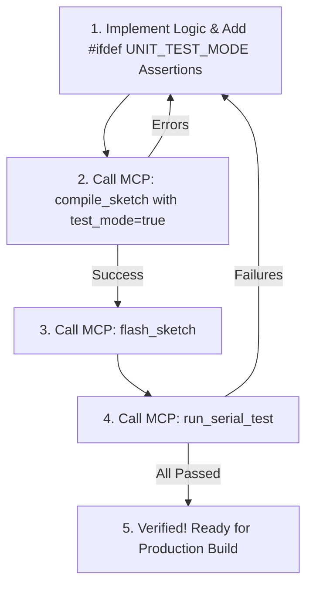

# Microcontroller Preprocessor-Guarded Unit Testing (MCU Agentic Testing)

This skill guides you through developing, testing, and debugging embedded microcontroller firmware using **Preprocessor-Guarded Detachable Unit Testing** (`#ifdef UNIT_TEST_MODE`), validated autonomously over Serial via the **Thruster MCP Server**.

## 1. Core Principles

When writing or modifying firmware for an MCU:

1. **Standard Arduino Architecture (`setup()` & `loop()`)**:
   - Write natural, idiomatic Arduino C++ code with standard `setup()` and `loop()`.
   - Structure sketches with clean helper functions and classes appropriate for the task.

2. **Separate Pure Logic from Direct Hardware IO**:
   - Write core calculations, math formulas, threshold checks, calibration curves, or packet decoders as standalone functions with explicit inputs and return values.
   - Example: Keep `int calculate_pwm(int raw_adc)` separate from `analogRead(A0)`. This allows mathematical logic to be verified independently of physical sensors.
   - See [Preprocessor Testing Reference](references/preprocessor_testing.md).

3. **Preprocessor-Guarded Tests (`#ifdef UNIT_TEST_MODE`)**:
   - Wrap test routines, assertions, and test serial prints inside `#ifdef UNIT_TEST_MODE`.
   - In test mode: `#ifdef UNIT_TEST_MODE` compiles the test assertions and prints `[PASS]` or `[FAIL]` tokens over Serial.
   - In production release: `UNIT_TEST_MODE` is undefined. The preprocessor strips all test code and strings, leaving **0 bytes** of Flash and RAM overhead in the final binary.
   - See [Detachable Tests Reference](references/detachable_tests.md).

4. **Machine-Parseable Serial Output**:
   - Test functions print concise assertion lines:
     `Serial.println(pass ? "[PASS] Description" : "[FAIL] Description");`
   - Thruster MCP automatically parses `[PASS]` and `[FAIL]` markers into structured test summaries.
   - See [Serial Protocol & MCP Reference](references/serial_testing_protocol.md).

---

## 2. The Agentic MCU Development Workflow

Always follow this closed-loop cycle when implementing features or fixing bugs:



### Step 1: Write Logic & Preprocessor-Guarded Test
```cpp
// In motor_control.cpp or main sketch:
int calculate_pwm_from_voltage(int raw_adc) {
    if (raw_adc < 1500) return 0;
    if (raw_adc > 4095) raw_adc = 4095;
    return (raw_adc - 1500) * 255 / (4095 - 1500);
}

#ifdef UNIT_TEST_MODE
void run_motor_tests() {
    Serial.println("=== MOTOR TESTS START ===");
    bool p1 = (calculate_pwm_from_voltage(1000) == 0);
    bool p2 = (calculate_pwm_from_voltage(4095) == 255);
    bool p3 = (calculate_pwm_from_voltage(1500) == 0);

    Serial.println(p1 ? "[PASS] Low cutoff below 1500" : "[FAIL] Low cutoff below 1500");
    Serial.println(p2 ? "[PASS] Max PWM at 4095" : "[FAIL] Max PWM at 4095");
    Serial.println(p3 ? "[PASS] Threshold boundary 1500" : "[FAIL] Threshold boundary 1500");
    Serial.println("=== MOTOR TESTS END ===");
}
#endif
```

In `setup()` of the sketch:
```cpp
void setup() {
    Serial.begin(115200);

#ifdef UNIT_TEST_MODE
    run_motor_tests();
#endif
}
```

### Step 2: Compile with Thruster MCP
Call the `compile_sketch` MCP tool with `test_mode: true`:
```json
{
  "test_mode": true
}
```
- Thruster automatically passes `-DUNIT_TEST_MODE=1` to the compiler.
- Verify `success: true`.
- If compiler errors occur, inspect `errors` and fix the code immediately.

### Step 3: Flash Firmware via Thruster MCP
Call the `flash_sketch` MCP tool to upload the binary to the connected board.

### Step 4: Execute Test via Serial Monitor
Call the `run_serial_test` MCP tool:
```json
{
  "timeout_ms": 6000
}
```
- Inspect `status`:
  - If `"PASS"`: All test assertions passed successfully!
  - If `"FAIL"`: Examine `failed_tests` and fix the logic.

### Step 5: Production Release Preparation
Once all tests pass:
- Running `compile_sketch` without `test_mode` (or standard Flash button in IDE) compiles the firmware without `UNIT_TEST_MODE`.
- All test code and strings are completely stripped—delivering an optimal production binary!
