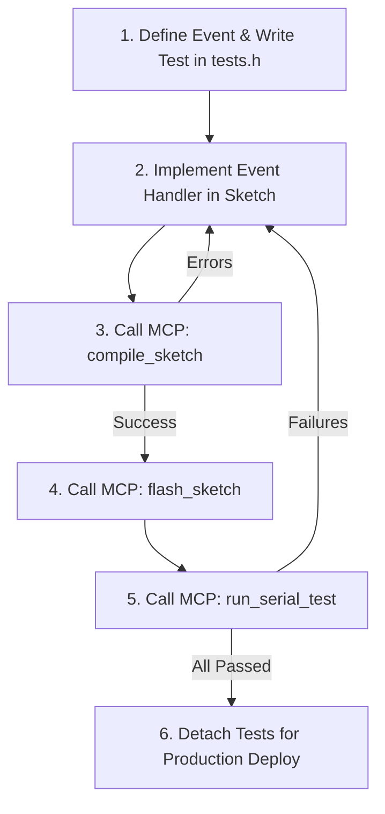

# Microcontroller Event-Driven Design & Test-Driven Development (MCU EDA & TDD)

This skill guides you through developing production-grade embedded microcontroller firmware using **Event-Driven Architecture (EDA)** and **Test-Driven Design (TDD)**, validated autonomously over Serial via the **Thruster MCP Server**.

## 1. Core Architectural Principles

When writing or modifying firmware for an MCU:

1. **Decouple Hardware from Logic (Event-Driven Architecture)**:
   - Physical inputs (pins, ADC, timers, interrupts) should **never** execute business logic directly.
   - Hardware polling functions only construct and post an `Event` object to `dispatch_event(type, data)`.
   - See [Event-Driven Design Reference](references/event_driven_design.md) for architectural patterns.

2. **Detachable Testing (`tests.h`)**:
   - All test suites, assertions, and serial command hooks must reside within `tests.h` and be guarded by `#if defined(THRUSTER_TEST_MODE)`.
   - In development: `#define THRUSTER_TEST_MODE 1` enables the test runner and Serial listener.
   - For production release: Simply commenting out `#define THRUSTER_TEST_MODE` compiles away **all** test logic and strings to exactly 0 bytes.
   - See [Detachable Tests Reference](references/detachable_tests.md).

3. **Machine-Testable Serial Protocol**:
   - Tests assert state and values using `TEST_ASSERT_TRUE`, `TEST_ASSERT_EQ`, and `TEST_ASSERT_STR_EQ`.
   - The test harness prints standard tokens: `[TEST:START]`, `[TEST:PASS]`, `[TEST:FAIL]`, and `[TEST:SUMMARY]`.
   - See [Serial Protocol & MCP Reference](references/serial_testing_protocol.md).

---

## 2. The Agentic MCU Development Workflow

Always follow this closed-loop cycle when adding features or fixing bugs:



### Step 1: Write the Failing Test Case
In your sketch under `#if defined(THRUSTER_TEST_MODE)`:
```cpp
void test_sensor_threshold_alarm() {
    dispatch_event(EVENT_SYSTEM_BOOT, 0);
    dispatch_event(EVENT_SENSOR_READING, 105); // Above 100 threshold
    TEST_ASSERT_EQ(current_state, STATE_ALARM, "Sensor above 100 must trigger ALARM");
}

void register_project_tests() {
    THRUSTER_REGISTER_TEST("sensor_alarm", test_sensor_threshold_alarm);
}
```

### Step 2: Implement or Modify the Event Handler
Update `dispatch_event(EventType type, int32_t data)` in the sketch to satisfy the test requirements.

### Step 3: Compile via Thruster MCP
Call the `compile_sketch` MCP tool:
```json
{
  "test_mode": true
}
```
- Verify `success: true`.
- Inspect `memory.flash` and `memory.ram` to confirm resource limits are respected.
- If syntax or linker errors occur, read `errors` and fix the code immediately.

### Step 4: Flash Firmware via Thruster MCP
Call the `flash_sketch` MCP tool to upload the binary to the connected board.
Verify that the upload finishes with `success: true`.

### Step 5: Execute Test via Serial Monitor
Call the `run_serial_test` MCP tool:
```json
{
  "command": "CMD:TEST:ALL",
  "expected_pattern": "\\[TEST:SUMMARY\\]",
  "timeout_ms": 6000
}
```
- Inspect `status`:
  - If `"PASS"`: All test assertions passed successfully!
  - If `"FAIL"`: Examine `failed_tests` and assertion messages with exact line numbers.
  - If `"TIMEOUT"`: Verify baud rate matches and sketch called `thruster_test_poll_serial()` in `loop()`.

### Step 6: Production Release Preparation
Once all tests pass and requirements are satisfied:
1. Comment out `#define THRUSTER_TEST_MODE 1` in the main sketch.
2. Run `compile_sketch` without `test_mode`. Verify that memory consumption shrinks and no test strings remain in flash.
3. Flash the clean production firmware to the board.
